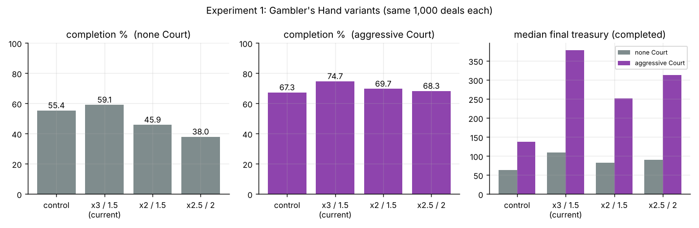
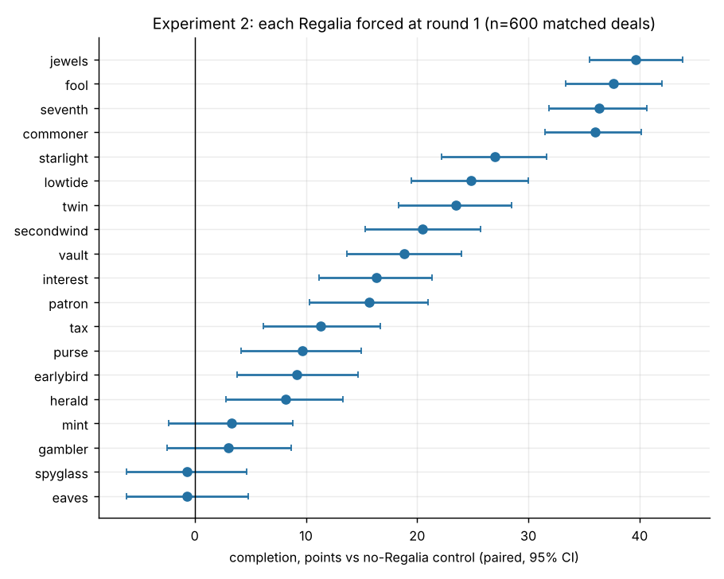
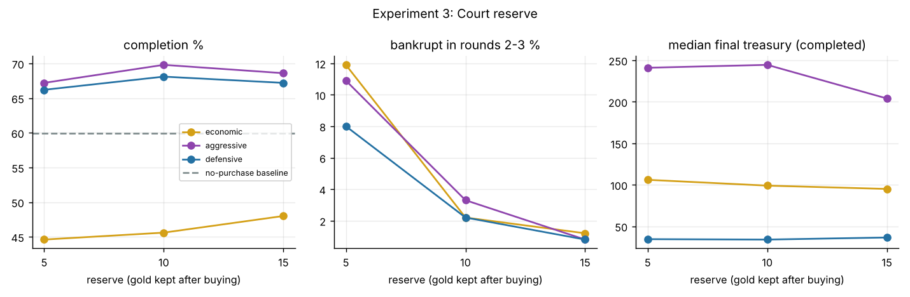
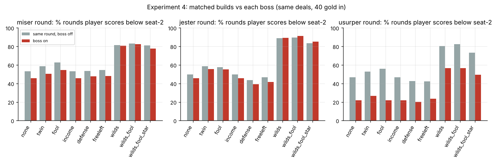
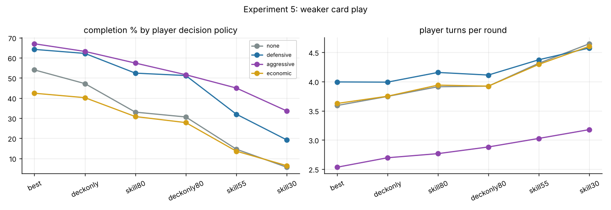

# The Run — Phase 2: Controlled Balance Experiments

*Built on the Phase 1 baseline (`../2026-11-16-run-001/balance_report.md`). Same unmodified game code; rule variants live only inside the simulator. Every number is computed from the CSVs in this folder.*

## 1. Summary

| # | Question | Answer |
|---|---|---|
| 1 | Gambler's Hand ×3/×1.5 vs ×2/×1.5 vs ×2.5/×2 | Its value depends on how often the player goes out. Alone (player goes out 38%), the current version adds +3.7 points of completion (not significant); both weaker versions *hurt* (-9.5 and -17.4). With the Aggressive Court (goes out 65%) it is strong: +7.4 points and a median final treasury of 378, against 252 for ×2/×1.5 and 313 for ×2.5/×2. |
| 2 | Each Regalia forced at round 1 | The three wild-rank Regalia and Court Fool are by far the strongest (jewels +40, fool +38, seventh +36, commoner +36 points over a 56% control). Income Regalia help much more when owned from round 1 (Interest +16, Patron +16) than Phase 1's after-the-fact comparison suggested. Gambler's Hand, Royal Mint, Spyglass and Eavesdropper show no detectable effect. |
| 3 | Court reserve 5 / 10 / 15 | A reserve of 10 cuts bankruptcies in rounds 2–3 from 11%/8%/12% (Aggressive/Defensive/Economic) to 3%/2%/2% and lifts completion modestly; 15 removes nearly all early bankruptcies but adds little more completion. |
| 4 | Bosses with matched builds | Against the Jester, the three wild-rank Regalia make the boss almost irrelevant (89% success vs 46% with no Regalia). The Usurper is the one boss that really bites (-25 points of success, +9.9 gold) and it switches Court Fool off completely. |
| 5 | Weaker card play | Everything gets much harder, and **buying matters far more for weaker players**. A player who slips 45% of the time completes 15% with no purchases, 32% with the Defensive Court and 45% with the Aggressive Court. Phase 1's "doing nothing is strong" holds only for best play. |

**How to read the rest.** Differences between conditions are *paired*: every condition replays the same 1,000 (Exp. 1, 3), 600 (Exp. 2), 500 (Exp. 5) or 2,000 (Exp. 4) deals, so intervals are much tighter than the Phase 1 group comparisons. Nothing here has been applied to the game.

## 2. Method and caveats common to all experiments

- **Paired seeds.** Within an experiment every condition uses the same seed list, so the opening deal is identical. After the first Court the random streams can drift apart (a purchase changes how many random numbers the Court uses), so pairing is exact only for the first deal. To measure how much this alone matters I included two Regalia that do nothing in this simulation (Spyglass and Eavesdropper, which only change what a human can see). They differ from the control by -0.7 points (95% CI -6.2 to +4.7). **Treat Experiment 2 differences smaller than about ±6 points as noise.**
- **Same game rules, same AI.** Experiments 1–4 use the Phase 1 best-play AI. Experiment 5 relaxes that.
- **Variants.** Gambler variants patch two numbers in an in-memory copy of the page code (×3 → ×N on going-out gold, ×1.5 → ×M on the penalty); fractional going-out gold is rounded down. `index.html` is unchanged.
- **Final treasury** in paired comparisons counts bankrupt runs as 0, so it mixes survival and gold. Median final treasury in the tables is over completed runs only.
- **Single-item tests are marginal effects at round 1 with nothing else bought.** They don't tell you how items combine.

## 3. Experiment 1 — Gambler's Hand variants

Gambler's Hand forced onto every run at round 1 (1,000 paired deals per row), in two contexts: no other purchases at all, and the Aggressive Court policy (which can also buy wild-rank Regalia, Court Fool and Early Bird).

| Court              | Variant                         | Completion   | vs control, points (95% CI)   | Bankrupt in rounds 2-3   |   Median final treasury (completed) |   90th pct |   Gambler net gold per owned round | Player goes out   |
|:-------------------|:--------------------------------|:-------------|:------------------------------|:-------------------------|------------------------------------:|-----------:|-----------------------------------:|:------------------|
| No Court purchases | No Gambler (control)            | 55.4%        |                               | 0.0%                     |                                  63 |        121 |                                    | 37.8%             |
| No Court purchases | x3 out / x1.5 penalty (current) | 59.1%        | +3.7 (-0.6 to +8.0)           | 0.0%                     |                                 110 |        214 |                                2.1 | 37.9%             |
| No Court purchases | x2 / x1.5                       | 45.9%        | -9.5 (-13.8 to -5.2)          | 0.0%                     |                                  82 |        164 |                               -1.5 | 38.2%             |
| No Court purchases | x2.5 / x2                       | 38.0%        | -17.4 (-21.8 to -13.2)        | 0.0%                     |                                  90 |        190 |                               -4.5 | 38.5%             |
| Aggressive Court   | No Gambler (control)            | 67.3%        |                               | 8.4%                     |                                 138 |        220 |                                    | 62.5%             |
| Aggressive Court   | x3 out / x1.5 penalty (current) | 74.7%        | +7.4 (+3.8 to +11.1)          | 10.3%                    |                                 378 |        572 |                               19.9 | 64.8%             |
| Aggressive Court   | x2 / x1.5                       | 69.7%        | +2.4 (-1.3 to +6.1)           | 10.7%                    |                                 252 |        395 |                                8.5 | 63.4%             |
| Aggressive Court   | x2.5 / x2                       | 68.3%        | +1.0 (-2.7 to +4.7)           | 12.2%                    |                                 313 |        480 |                               12   | 64.1%             |

- **Why the result flips with context.** Gambler's Hand pays on the rounds where you go out and costs on the rounds where you don't. With no other items the player goes out about 38% of rounds, so the 5.4 gold of extra penalty per round nearly cancels the 7.6 gold of bonus (net +2.1). With Aggressive purchases the player goes out 65% of rounds and the same item nets +19.9.
- **Weaker multipliers.** ×2/×1.5 nets -1.5 alone and +8.5 with Aggressive purchases; ×2.5/×2 nets -4.5 and +12.0. Doubling the penalty multiplier is more damaging than trimming the bonus: ×2.5/×2 is worse than ×2/×1.5 in both contexts.
- **Inflation.** In the Aggressive context ×2/×1.5 lowers the median final treasury from 378 to 252 (still above the 138 with no Gambler) while keeping completion above the control (+2.4 points, not significant).
- **Early busts.** With the Aggressive Court the item raises bankruptcies in rounds 2–3 slightly (8.4% → 10.3% / 10.7% / 12.2%), because heavier penalties arrive before the bonus does.

## 4. Experiment 2 — each Regalia forced at round 1

Each Regalia given free at round 1 to 600 matched deals, no other purchases, compared with the same deals and no Regalia. Control completion 55.8%, penalty 9.1 gold per round, median final treasury 62.

| Regalia (forced at round 1)   |   Price | Completion   | vs control, points (95% CI)   | p (Holm-adj.)   |   Rounds reached |   Penalties paid per run |   Gold generated per run |   Points per gold |
|:------------------------------|--------:|:-------------|:------------------------------|:----------------|-----------------:|-------------------------:|-------------------------:|------------------:|
| jewels                        |      24 | 95.5%        | +39.7 (+35.5 to +43.8)        | <0.001          |             1.28 |                    -31   |                      +49 |              1.65 |
| fool                          |      15 | 93.5%        | +37.7 (+33.3 to +42.0)        | <0.001          |             1.33 |                    -22.6 |                      +33 |              2.51 |
| seventh                       |      24 | 92.2%        | +36.3 (+31.8 to +40.7)        | <0.001          |             1.09 |                    -36.4 |                      +44 |              1.51 |
| commoner                      |      22 | 91.8%        | +36.0 (+31.5 to +40.2)        | <0.001          |             1.07 |                    -30.3 |                      +43 |              1.64 |
| starlight                     |      13 | 82.8%        | +27.0 (+22.2 to +31.7)        | <0.001          |             0.94 |                    -26.7 |                       +2 |              2.08 |
| lowtide                       |      13 | 80.7%        | +24.8 (+19.5 to +30.0)        | <0.001          |             0.71 |                    -26.6 |                       +3 |              1.91 |
| twin                          |      16 | 79.3%        | +23.5 (+18.3 to +28.5)        | <0.001          |             0.76 |                    -16.7 |                      +19 |              1.47 |
| secondwind                    |       9 | 76.3%        | +20.5 (+15.3 to +25.7)        | <0.001          |             0.85 |                     10.7 |                       +7 |              2.28 |
| vault                         |      12 | 74.7%        | +18.8 (+13.7 to +24.0)        | <0.001          |             0.43 |                    -14.8 |                       +3 |              1.57 |
| interest                      |      10 | 72.2%        | +16.3 (+11.2 to +21.3)        | <0.001          |             0.41 |                      5.9 |                      +43 |              1.63 |
| patron                        |      10 | 71.5%        | +15.7 (+10.3 to +21.0)        | <0.001          |             0.49 |                      6.7 |                      +33 |              1.57 |
| tax                           |       9 | 67.2%        | +11.3 (+6.2 to +16.7)         | <0.001          |             0.34 |                      4.5 |                      +23 |              1.26 |
| purse                         |       9 | 65.5%        | +9.7 (+4.2 to +15.0)          | 0.004           |             0.3  |                     -7.3 |                       +1 |              1.07 |
| earlybird                     |       6 | 65.0%        | +9.2 (+3.8 to +14.7)          | 0.007           |             0.12 |                      2.1 |                      +22 |              1.53 |
| herald                        |       9 | 64.0%        | +8.2 (+2.8 to +13.3)          | 0.019           |             0.12 |                      2   |                      +19 |              0.91 |
| mint                          |       6 | 59.2%        | +3.3 (-2.3 to +8.8)           | 1.000           |            -0.09 |                     -0.7 |                       +8 |              0.56 |
| gambler                       |       4 | 58.8%        | +3.0 (-2.5 to +8.7)           | 1.000           |            -0.2  |                     36.9 |                      +69 |              0.75 |
| eaves                         |       5 | 55.2%        | -0.7 (-6.2 to +4.8)           | 1.000           |            -0.2  |                     -2.4 |                       -3 |             -0.13 |
| spyglass                      |      10 | 55.2%        | -0.7 (-6.2 to +4.7)           | 1.000           |            -0.2  |                     -2.4 |                       -3 |             -0.07 |

*Points per gold = completion gain per gold of list price. Holm adjustment covers the 19 comparisons.*

- **Strongest, in absolute terms:** the wild-rank Regalia (Crown Jewels, Seventh Heaven, Commoner's Crown) and Court Fool, each worth about 36–40 points. Starlight and Low Tide follow (about 25–27).
- **Best per gold spent:** fool (2.51), secondwind (2.28), starlight (2.08), lowtide (1.91) points per gold. **Worst per gold among items that work:** Herald (0.91) and Royal Mint (not distinguishable from zero).
- **Income Regalia work when owned early** (Interest, Patron, Tax: +11 to +16 points). Phase 1 saw them as weak because they're bought later by runs that already have the gold; this experiment removes that selection.
- **Gambler's Hand alone** is +3.0 points with an interval spanning zero: consistent with Experiment 1.
- **Second Wind** adds +20 points although it saves no penalty gold on average: it simply converts one bankruptcy into a continuation.

## 5. Experiment 3 — Court reserve

Same deals, three listed-item Court policies, reserve (gold the policy must keep after paying) 5, 10 or 15; 1,000 paired runs per row. A free boss-bounty pick ignores the reserve.

| Court policy   |   Reserve | Bankrupt in rounds 2-3   | Completion   | vs reserve 5 (points, 95% CI)   |   vs no-purchase baseline (points) |   Mean round reached |   Median final treasury |
|:---------------|----------:|:-------------------------|:-------------|:--------------------------------|-----------------------------------:|---------------------:|------------------------:|
| economic       |         5 | 11.9%                    | 44.6%        |                                 |                              -15.3 |                 7.64 |                     106 |
| economic       |        10 | 2.2%                     | 45.6%        | +1.0 (-1.1 to +3.1)             |                              -14.3 |                 8.19 |                      99 |
| economic       |        15 | 1.2%                     | 48.0%        | +3.4 (+0.5 to +6.3)             |                              -11.9 |                 8.41 |                      95 |
| aggressive     |         5 | 10.9%                    | 67.2%        |                                 |                                7.3 |                 8.73 |                     241 |
| aggressive     |        10 | 3.3%                     | 69.8%        | +2.6 (+0.2 to +5.1)             |                                9.9 |                 9.2  |                     244 |
| aggressive     |        15 | 0.8%                     | 68.6%        | +1.4 (-1.9 to +4.7)             |                                8.7 |                 9.27 |                     204 |
| defensive      |         5 | 8.0%                     | 66.2%        |                                 |                                6.3 |                 9.09 |                      34 |
| defensive      |        10 | 2.2%                     | 68.1%        | +1.9 (-0.8 to +4.6)             |                                8.2 |                 9.38 |                      34 |
| defensive      |        15 | 0.8%                     | 67.2%        | +1.0 (-2.1 to +4.3)             |                                7.3 |                 9.46 |                      36 |

- **Early bankruptcies fall steadily** as the reserve rises (reserve 10: about a 6–10 point drop; reserve 15: about a 7–11 point drop), for all three policies.
- **Completion improves less**, and not always significantly: Economic gains +3.4 points at 15; Aggressive peaks at 10 (+2.6); Defensive gains +1.9 / +1.0 at 10 / 15 (neither significant).
- **A bigger reserve also means buying fewer or later items**, which shows up as a lower final treasury for Aggressive (241 → 204).
- **With 1,000 paired deals, Aggressive and Defensive beat the no-purchase baseline at every reserve** (+6 to +10 points), where Phase 1's 200-run comparison was inconclusive. Economic stays well below it at every reserve.

## 6. Experiment 4 — bosses with matched builds

Single-round encounters: each deal is played at the boss round with a fixed 40 gold, with each build, **boss on and boss off** (the same round number with the boss rule removed; seat 1 then plays at the normal tier rather than boss skill, so "boss off" isn't a perfect control). 2,000 deals per cell. "Success" is the player scoring strictly less than seat 1, the game's own boss test.

### The Jester (round 8)

| Build                              | Success with boss   | vs no-Regalia build (points, 95% CI)   | Same round, boss off   |   Boss effect on success (points) |   Penalty paid with boss |   Boss effect on penalty (gold) | Bankrupt (40 gold in)   |
|:-----------------------------------|:--------------------|:---------------------------------------|:-----------------------|----------------------------------:|-------------------------:|--------------------------------:|:------------------------|
| no Regalia                         | 45.8%               |                                        | 49.7%                  |                              -3.9 |                     11.6 |                             3.7 | 8.4%                    |
| Twin Crowns                        | 55.5%               | +9.7 (+7.8 to +11.6)                   | 58.8%                  |                              -3.4 |                      7.3 |                             2.6 | 3.4%                    |
| Court Fool                         | 55.2%               | +9.4 (+7.7 to +11.2)                   | 57.5%                  |                              -2.2 |                      5.6 |                             1.9 | 1.2%                    |
| Patron + Interest + Tax            | 45.8%               | +0.0 (+0.0 to +0.0)                    | 49.7%                  |                              -3.9 |                     11.6 |                             3.7 | 8.4%                    |
| Second Wind + Vault + Starlight    | 39.4%               | -6.5 (-8.5 to -4.3)                    | 43.6%                  |                              -4.3 |                      6.2 |                             2.4 | 0.0%                    |
| Starlight + Low Tide + Heavy Purse | 41.8%               | -4.0 (-6.6 to -1.6)                    | 46.8%                  |                              -5   |                      3.4 |                             2.1 | 0.2%                    |
| Commoner + Seventh + Crown Jewels  | 89.3%               | +43.5 (+41.1 to +45.7)                 | 88.8%                  |                               0.5 |                      0.4 |                             0.2 | 0.1%                    |
| the three wilds + Court Fool       | 91.1%               | +45.4 (+43.0 to +47.6)                 | 89.5%                  |                               1.7 |                      0.2 |                             0.1 | 0.0%                    |
| three wilds + Fool + Starlight     | 85.2%               | +39.5 (+37.1 to +41.9)                 | 83.4%                  |                               1.9 |                      0.1 |                             0.1 | 0.0%                    |

- **The Jester itself is mild:** with no Regalia it lowers success by 3.9 points and adds 3.7 gold to the bill.
- **Extra wild ranks neutralise it** (success 89%; boss effect about zero; bill under 1 gold). The Jester changes the wild rank each turn but cannot take away a fixed wild rank.
- **Free-leftover and defensive builds do not help the Jester fight** (Starlight/Low Tide/Purse and Second Wind/Vault/Starlight are -4.0 and -6.5 points on success), because they make leftovers cheaper rather than helping you go out; they do cut the bill.

### The Miser (round 4)

| Build                              | Success with boss   | vs no-Regalia build (points, 95% CI)   | Same round, boss off   |   Boss effect on success (points) |   Penalty paid with boss |   Boss effect on penalty (gold) | Bankrupt (40 gold in)   |
|:-----------------------------------|:--------------------|:---------------------------------------|:-----------------------|----------------------------------:|-------------------------:|--------------------------------:|:------------------------|
| no Regalia                         | 45.6%               |                                        | 53.1%                  |                              -7.4 |                     10.3 |                             1   | 5.7%                    |
| Twin Crowns                        | 50.4%               | +4.8 (+3.8 to +5.8)                    | 58.8%                  |                              -8.4 |                      7.3 |                             0.8 | 2.1%                    |
| Court Fool                         | 54.6%               | +8.9 (+7.6 to +10.3)                   | 62.7%                  |                              -8.2 |                      4.5 |                             1.1 | 0.1%                    |
| Patron + Interest + Tax            | 45.6%               | +0.0 (+0.0 to +0.0)                    | 53.1%                  |                              -7.4 |                     10.3 |                             1   | 5.7%                    |
| Second Wind + Vault + Starlight    | 47.6%               | +2.0 (+0.7 to +3.4)                    | 53.5%                  |                              -5.9 |                      5.1 |                             0.7 | 0.0%                    |
| Starlight + Low Tide + Heavy Purse | 48.0%               | +2.4 (+0.7 to +4.0)                    | 54.6%                  |                              -6.7 |                      2.4 |                             0.5 | 0.1%                    |
| Commoner + Seventh + Crown Jewels  | 80.8%               | +35.1 (+33.1 to +37.2)                 | 81.6%                  |                              -0.9 |                      0.9 |                             0.3 | 0.1%                    |
| the three wilds + Court Fool       | 82.5%               | +36.9 (+34.8 to +39.1)                 | 83.2%                  |                              -0.7 |                      0.3 |                             0.2 | 0.0%                    |
| three wilds + Fool + Starlight     | 77.7%               | +32.0 (+30.0 to +34.2)                 | 81.0%                  |                              -3.4 |                      0.1 |                             0.1 | 0.0%                    |

### The Usurper (round 11)

| Build                              | Success with boss   | vs no-Regalia build (points, 95% CI)   | Same round, boss off   |   Boss effect on success (points) |   Penalty paid with boss |   Boss effect on penalty (gold) | Bankrupt (40 gold in)   |
|:-----------------------------------|:--------------------|:---------------------------------------|:-----------------------|----------------------------------:|-------------------------:|--------------------------------:|:------------------------|
| no Regalia                         | 21.9%               |                                        | 46.8%                  |                             -24.8 |                     17.4 |                             9.9 | 13.8%                   |
| Twin Crowns                        | 26.8%               | +4.9 (+3.7 to +6.1)                    | 52.8%                  |                             -25.9 |                     12.9 |                             7.5 | 7.5%                    |
| Court Fool                         | 21.9%               | +0.0 (+0.0 to +0.0)                    | 56.0%                  |                             -34   |                     17.4 |                            14.1 | 13.8%                   |
| Patron + Interest + Tax            | 21.9%               | +0.0 (+0.0 to +0.0)                    | 46.8%                  |                             -24.8 |                     17.4 |                             9.9 | 13.8%                   |
| Second Wind + Vault + Starlight    | 20.3%               | -1.7 (-3.1 to -0.1)                    | 42.6%                  |                             -22.3 |                      8.3 |                             5   | 0.0%                    |
| Starlight + Low Tide + Heavy Purse | 23.8%               | +1.8 (-0.1 to +3.7)                    | 42.3%                  |                             -18.6 |                      5.3 |                             4.1 | 1.7%                    |
| Commoner + Seventh + Crown Jewels  | 56.5%               | +34.6 (+32.6 to +36.6)                 | 80.3%                  |                             -23.8 |                      2.8 |                             2.3 | 1.1%                    |
| the three wilds + Court Fool       | 56.5%               | +34.6 (+32.5 to +36.6)                 | 82.5%                  |                             -26   |                      2.8 |                             2.6 | 1.1%                    |
| three wilds + Fool + Starlight     | 49.4%               | +27.5 (+25.2 to +29.6)                 | 73.3%                  |                             -23.9 |                      1.7 |                             1.7 | 0.7%                    |

- **The Usurper is the only boss with a large effect** (25 points of success even for builds that dominate the others).
- **Court Fool is dead against the Usurper** (identical results to no Regalia): the code doesn't deal the extra Joker that round.
- **The income build is identical to no Regalia in a single round**, as it must be; its value is gold between rounds, not card play.

## 7. Experiment 5 — weaker card play

The player's decisions are degraded using the game's own computer-level mechanism ("slips" = with that probability the move is replaced by a random one) and one extra policy, never taking the discard pile. 500 paired runs per cell. These are **illustrative stand-ins, not measured human behaviour**: I have no data on how people actually play.

| Player                       | No purchases   | Defensive   | Aggressive   | Economic   | Goes out   |   Turns per round |
|:-----------------------------|:---------------|:------------|:-------------|:-----------|:-----------|------------------:|
| Best play (Phase 1)          | 54.0%          | 64.2%       | 67.0%        | 42.4%      | 38.0%      |               3.6 |
| Never takes the discard pile | 47.2%          | 62.2%       | 63.2%        | 40.2%      | 34.7%      |               3.7 |
| Slips 20% of the time        | 33.0%          | 52.4%       | 57.4%        | 30.8%      | 33.9%      |               3.9 |
| No discard pile + slips 20%  | 30.6%          | 51.2%       | 51.6%        | 27.8%      | 33.3%      |               3.9 |
| Slips 45% of the time        | 14.6%          | 32.0%       | 45.0%        | 13.6%      | 30.1%      |               4.3 |
| Slips 70% of the time        | 5.6%           | 19.2%       | 33.6%        | 6.4%       | 28.1%      |               4.6 |

Gain from buying, by player quality:

| Player                | Court      | Completion   | No purchases   |   Gain from buying (points) |
|:----------------------|:-----------|:-------------|:---------------|----------------------------:|
| Best play (Phase 1)   | defensive  | 64.2%        | 54.0%          |                        10.2 |
| Slips 20% of the time | defensive  | 52.4%        | 33.0%          |                        19.4 |
| Slips 45% of the time | defensive  | 32.0%        | 14.6%          |                        17.4 |
| Slips 70% of the time | defensive  | 19.2%        | 5.6%           |                        13.6 |
| Best play (Phase 1)   | aggressive | 67.0%        | 54.0%          |                        13   |
| Slips 20% of the time | aggressive | 57.4%        | 33.0%          |                        24.4 |
| Slips 45% of the time | aggressive | 45.0%        | 14.6%          |                        30.4 |
| Slips 70% of the time | aggressive | 33.6%        | 5.6%           |                        28   |
| Best play (Phase 1)   | economic   | 42.4%        | 54.0%          |                       -11.6 |
| Slips 20% of the time | economic   | 30.8%        | 33.0%          |                        -2.2 |
| Slips 45% of the time | economic   | 13.6%        | 14.6%          |                        -1   |
| Slips 70% of the time | economic   | 6.4%         | 5.6%           |                         0.8 |

- **Completion falls quickly** as play weakens: with no purchases from 54% (best) to 33% (slips 20%), 15% (45%), 6% (70%). Even a 20% slip rate costs 21 points with no purchases and about 12–10 with the Defensive or Aggressive Court.
- **Never taking the discard pile costs relatively little** (-7 points with no purchases) but makes rounds longer (3.7 vs 3.6 turns).
- **Purchases protect weaker players.** At 45% slips, Aggressive purchases are worth +30 points and Defensive +17, against +13 and +10 for best play. Economic remains the weakest policy at every skill level.
- **Early bankruptcies increase with weaker play** under the same reserve of 5 (Defensive 8% → 15% at 45% slips), which strengthens the case for Experiment 3's larger reserve for human players.
- **Turn-based items** shift with play quality: the player goes out in fewer rounds (62% → 55% with the Aggressive Court), which weakens going-out income (Gambler's Hand, Herald, Early Bird).

## 8. What changes from Phase 1

| Phase 1 said | Phase 2 shows |
|---|---|
| Income Regalia add little survival (Potential) | They help clearly when owned from round 1 (Interest, Patron, Tax +11 to +16 points). Phase 1's comparison was confounded by timing. |
| Doing nothing is as good as buying (Potential) | True only for best play. At 45% slips, Aggressive purchases are worth +30 points and Defensive +17; Economic still adds nothing. |
| Gambler's Hand is underpriced (Evidence-backed) | Narrowed: very strong with out-rate boosters, roughly neutral alone, and negative at weaker multipliers. The problem is its synergy and the gold surplus it produces, not its stand-alone strength. |
| Jester interacts with wild builds (Potential) | Confirmed and sharpened: three wild-rank Regalia remove the Jester's effect. |
| Early deaths come from low reserves (Evidence-backed) | Confirmed with a dose-response (5 → 10 → 15). |

## 9. Findings and options (nothing applied)

| # | Finding | Class | Evidence | Option to consider | Follow-up |
|---|---|---|---|---|---|
| 1 | Wild-rank Regalia and Court Fool dominate everything else | Evidence-backed | +36 to +40 points each at round 1; boss rounds, success ~89% vs 46% at the Jester | Reprice, limit stacking, or accept as the "power" tier | Test stacked wilds with a mid-run purchase rather than round 1 |
| 2 | Herald, Royal Mint and Gambler's Hand (alone) give little survival per gold | Evidence-backed (single-item, round 1) | below ~1 point per gold, Mint indistinguishable from zero | Consider re-pricing or strengthening | Re-test after changes |
| 3 | Gambler's Hand ×2/×1.5 would cut the gold surplus by about a third in Aggressive runs but make it a trap when bought alone | Evidence-backed (effects), design judgement (whether it matters) | Experiment 1 | Keep ×3 if the surplus is acceptable; otherwise soften the bonus but leave the penalty at ×1.5 or lower (doubling the penalty hurt most) | Try ×2/×1.25 and ×2.5/×1.5 |
| 4 | A reserve of about 10 is the sweet spot for buying policies | Evidence-backed | Experiment 3 | Show a warning below 10 after a purchase in rounds 1–3 | Human Court spending data |
| 5 | The Usurper turns Court Fool off and has by far the largest boss effect | Evidence-backed | Experiment 4 | Confirm it is intended | — |
| 6 | The Jester is trivial for wild-rank builds and mild for others | Evidence-backed | Experiment 4 | Optional: let the Jester also affect fixed wild ranks | Test the change at the Jester |
| 7 | Buying matters much more for weaker players, so all balance numbers depend on assumed skill | Evidence-backed (that it depends); **Not enough evidence** for what real players are like | Experiment 5 | Collect real play data (turn decisions, out rates) to calibrate | Log anonymised decisions in the app |
| 8 | Information-only items still cannot be evaluated | Not enough evidence | no effect in these runs | — | Human study |

## 10. Limits

- Weak-play policies are stand-ins; real people differ in *which* mistakes they make, not just how often.
- Pairing is exact only for the first deal (see §2); intervals are conservative for that reason but not exact.
- Marginal single-item effects do not predict combinations.
- Boss tests start at the boss round with 40 gold, so they say nothing about arrival state; Phase 1 covers that.
- Court policies are still my heuristics (reserve aside).
- p-values are exact McNemar tests on paired completions; Experiment 2 is Holm-adjusted, the others are not adjusted for multiple comparisons.

## 11. Validation

- PASS: e1: 8 conditions x 1000 runs, identical seed list in every condition (paired)
- PASS: e1: no run exceeds 11 rounds
- PASS: e2: 20 conditions x 600 runs, identical seed list in every condition (paired)
- PASS: e2: no run exceeds 11 rounds
- PASS: e3: 10 conditions x 1000 runs, identical seed list in every condition (paired)
- PASS: e3: no run exceeds 11 rounds
- PASS: e5: 24 conditions x 500 runs, identical seed list in every condition (paired)
- PASS: e5: no run exceeds 11 rounds
- PASS: e1 (no-Court): going-out reward equals 10 x the variant multiplier (30 / 20 / 25) and 0 for control, in every round the player went out
- PASS: e1 (no-Court, rounds 4-11): penalty paid = ceil(raw x variant penalty multiplier)
- PASS: e1: Gambler's Hand owned at the end in every variant run, never in control
- PASS: e2: forced Regalia owned at the end of every run (no-Court never sells; Second Wind may be used up) (12000 runs)
- PASS: e2: control runs bought nothing
- PASS: e4: every boss x build x on/off cell has the same encounter count (2000 per cell)
- PASS: e4: boss rounds are 4 / 8 / 11
- PASS: e4: income-only build plays identically to no build (it cannot change card play) in all 6 boss/on-off cells
- PASS: e4: Court Fool changes nothing against the Usurper (code disables it) but does elsewhere
- PASS: e4: nobody enters with other than 40 gold
- PASS: re-running 242 sampled runs from their seeds and conditions reproduces them exactly
- PASS: all 242 sampled runs' round ledgers reconcile

## 12. Files

`e1_runs.csv`/`e1_rounds.csv` … `e5_*` (raw per-run and per-round records for each experiment), `e4_encounters.csv`, `tables/*.csv` (summaries and paired comparisons with confidence intervals), `charts/*.png`, `config_e*.json`, `validation_results.json`.

Reproduce: `node simulation/experiments.js all --out <dir>` → `python3 simulation/analyze_phase2.py <dir>` → `node simulation/validate_phase2.js <dir>` → `python3 simulation/make_report_phase2.py <dir>`.
