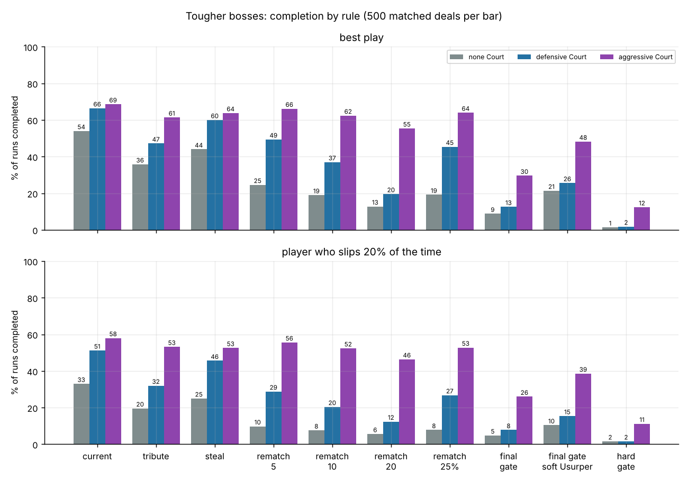
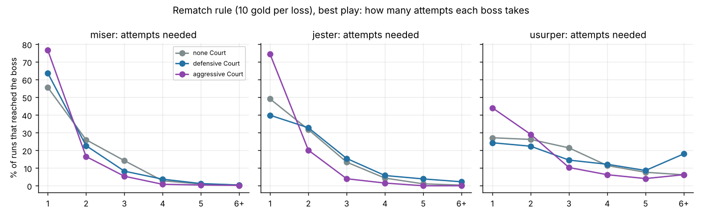

# The Run — Tougher Bosses ("you have to beat them")

*Simulator-only rule variants on the unmodified game code. 84 conditions, 500 matched deals each. Listed Court policies keep a 10-gold reserve. Nothing has been changed in the game.*

## 1. Short answer

- **A strict gate ends almost every run.** If losing to any boss ends the run, completion falls to 1% with no purchases, 2% with the Defensive Court and 12% with the Aggressive Court (best play).
- **Rematch-until-you-win is workable, but only for builds that help you go out.** With a 5-gold toll the Aggressive Court barely notices (69% → 66%), while the Defensive Court drops from 66% to 49% and no-purchase play from 54% to 25%.
- **The real price of a rematch is the bill, not the toll.** Even with no toll at all, no-purchase completion falls to 32%, because every lost attempt still costs the hand's points in gold.
- **The Miser becomes the wall.** Under the 5-gold rematch rule 31% of no-purchase runs and 25% of Aggressive runs end at round 4 (now: 10% and 14%), because players arrive there with little gold.
- **The Usurper needs softening under any "must beat" rule.** He takes 2.3–3.8 attempts on average. If his dead Jokers applied to everyone, that drops to 1.4–2.2.
- **A toll set as a share of the treasury is the best gold sink.** At 25% per loss, completion is about the same as a flat 5–10 gold, but rich Aggressive runs finish with a median of 238 gold instead of 306.

## 2. Completion by rule

Best play. Figures in brackets are points versus current rules on the same deals (roughly ±4 points of noise).

| Rule                                                        | No purchases   | Defensive Court   | Aggressive Court   |
|:------------------------------------------------------------|:---------------|:------------------|:-------------------|
| Current rules                                               | 54%            | 66%               | 69%                |
| Boss takes your priciest Regalia                            | 44% (-10)      | 60% (-6)          | 64% (-5)           |
| Tribute on a loss (10 / 15 / 20 gold)                       | 36% (-18)      | 47% (-19)         | 61% (-7)           |
| Rematch, no toll                                            | 32% (-22)      | 63% (-4)          | 72% (+3)           |
| Rematch, 5 gold per loss                                    | 25% (-29)      | 49% (-17)         | 66% (-2)           |
| Rematch, 10 gold per loss                                   | 19% (-35)      | 37% (-29)         | 62% (-6)           |
| Rematch, 5 / 10 / 15 … rising                               | 20% (-34)      | 35% (-31)         | 64% (-5)           |
| Rematch, 20 gold per loss                                   | 13% (-41)      | 20% (-47)         | 55% (-13)          |
| Rematch, 25% of treasury per loss (min 5)                   | 19% (-35)      | 45% (-21)         | 64% (-5)           |
| Rematch 5, softer Usurper                                   | 41% (-13)      | 59% (-7)          | 67% (-1)           |
| Rematch 5 for Miser and Jester; must beat Usurper first try | 9% (-45)       | 13% (-54)         | 30% (-39)          |
| Final-boss gate, softer Usurper                             | 21% (-33)      | 26% (-41)         | 48% (-20)          |
| Lose to any boss = run over                                 | 1% (-53)       | 2% (-65)          | 12% (-56)          |

A player who slips 20% of the time:

| Rule                                                        | No purchases   | Defensive Court   | Aggressive Court   |
|:------------------------------------------------------------|:---------------|:------------------|:-------------------|
| Current rules                                               | 33%            | 51%               | 58%                |
| Boss takes your priciest Regalia                            | 25% (-8)       | 46% (-6)          | 53% (-5)           |
| Tribute on a loss (10 / 15 / 20 gold)                       | 20% (-13)      | 32% (-19)         | 53% (-5)           |
| Rematch, no toll                                            | 14% (-19)      | 41% (-10)         | 59% (+1)           |
| Rematch, 5 gold per loss                                    | 10% (-23)      | 29% (-22)         | 56% (-2)           |
| Rematch, 10 gold per loss                                   | 8% (-25)       | 20% (-31)         | 52% (-6)           |
| Rematch, 5 / 10 / 15 … rising                               | 9% (-24)       | 21% (-30)         | 53% (-5)           |
| Rematch, 20 gold per loss                                   | 6% (-27)       | 12% (-39)         | 46% (-12)          |
| Rematch, 25% of treasury per loss (min 5)                   | 8% (-25)       | 27% (-24)         | 53% (-5)           |
| Rematch 5, softer Usurper                                   | 22% (-11)      | 41% (-10)         | 57% (-1)           |
| Rematch 5 for Miser and Jester; must beat Usurper first try | 5% (-28)       | 8% (-43)          | 26% (-32)          |
| Final-boss gate, softer Usurper                             | 10% (-23)      | 15% (-36)         | 39% (-19)          |
| Lose to any boss = run over                                 | 2% (-31)       | 2% (-50)          | 11% (-47)          |

*"Softer Usurper" = his dead Jokers apply to every seat, not only the player.*

## 3. What the rematch rule does to a run (best play)

**Aggressive Court**

| Rule                                      | Completed   | Ended at Miser   | at Jester   | at Usurper   | Attempts: Miser / Jester / Usurper   | Runs with 3+ attempts at one boss   |   Most attempts seen |   Rounds played per run |   Gold paid in tolls |   Median final treasury |
|:------------------------------------------|:------------|:-----------------|:------------|:-------------|:-------------------------------------|:------------------------------------|---------------------:|------------------------:|---------------------:|------------------------:|
| Current rules                             | 69%         | 14%              | 2%          | 1%           | —                                    | 0%                                  |                    0 |                     9.1 |                    0 |                     239 |
| Rematch, no toll                          | 72%         | 21%              | 1%          | 1%           | 1.5 / 1.3 / 2.4                      | 31%                                 |                   19 |                    10.8 |                    0 |                     292 |
| Rematch, 5 gold per loss                  | 66%         | 25%              | 1%          | 2%           | 1.4 / 1.3 / 2.3                      | 27%                                 |                   15 |                    10.3 |                    8 |                     306 |
| Rematch, 10 gold per loss                 | 62%         | 28%              | 2%          | 2%           | 1.3 / 1.3 / 2.3                      | 25%                                 |                   15 |                     9.9 |                   14 |                     304 |
| Rematch, 20 gold per loss                 | 55%         | 34%              | 3%          | 3%           | 1.2 / 1.3 / 2.2                      | 20%                                 |                   15 |                     9.3 |                   25 |                     301 |
| Rematch, 25% of treasury per loss (min 5) | 64%         | 25%              | 1%          | 3%           | 1.4 / 1.3 / 2.2                      | 27%                                 |                    9 |                    10.2 |                   53 |                     238 |
| Rematch 5, softer Usurper                 | 67%         | 25%              | 1%          | 1%           | 1.4 / 1.3 / 1.4                      | 17%                                 |                    8 |                     9.7 |                    5 |                     318 |

**Defensive Court**

| Rule                                      | Completed   | Ended at Miser   | at Jester   | at Usurper   | Attempts: Miser / Jester / Usurper   | Runs with 3+ attempts at one boss   |   Most attempts seen |   Rounds played per run |   Gold paid in tolls |   Median final treasury |
|:------------------------------------------|:------------|:-----------------|:------------|:-------------|:-------------------------------------|:------------------------------------|---------------------:|------------------------:|---------------------:|------------------------:|
| Current rules                             | 66%         | 11%              | 3%          | 3%           | —                                    | 0%                                  |                    0 |                     9.2 |                    0 |                      33 |
| Rematch, no toll                          | 63%         | 21%              | 4%          | 6%           | 1.8 / 2.2 / 4.2                      | 59%                                 |                   21 |                    13   |                    0 |                      69 |
| Rematch, 5 gold per loss                  | 49%         | 27%              | 7%          | 11%          | 1.7 / 2.2 / 3.8                      | 54%                                 |                   16 |                    11.6 |                   16 |                      54 |
| Rematch, 10 gold per loss                 | 37%         | 31%              | 11%         | 14%          | 1.6 / 2.1 / 3.3                      | 47%                                 |                   12 |                    10.5 |                   26 |                      49 |
| Rematch, 20 gold per loss                 | 20%         | 43%              | 15%         | 17%          | 1.3 / 1.7 / 2.3                      | 24%                                 |                    7 |                     8.3 |                   32 |                      48 |
| Rematch, 25% of treasury per loss (min 5) | 45%         | 28%              | 7%          | 14%          | 1.7 / 2.1 / 3.6                      | 53%                                 |                   12 |                    11.4 |                   24 |                      44 |
| Rematch 5, softer Usurper                 | 59%         | 27%              | 7%          | 1%           | 1.7 / 2.2 / 2.2                      | 44%                                 |                   10 |                    10.7 |                   11 |                      63 |

**No purchases**

| Rule                                      | Completed   | Ended at Miser   | at Jester   | at Usurper   | Attempts: Miser / Jester / Usurper   | Runs with 3+ attempts at one boss   |   Most attempts seen |   Rounds played per run |   Gold paid in tolls |   Median final treasury |
|:------------------------------------------|:------------|:-----------------|:------------|:-------------|:-------------------------------------|:------------------------------------|---------------------:|------------------------:|---------------------:|------------------------:|
| Current rules                             | 54%         | 10%              | 6%          | 9%           | —                                    | 0%                                  |                    0 |                     9.3 |                    0 |                      57 |
| Rematch, no toll                          | 32%         | 24%              | 12%         | 22%          | 1.9 / 1.9 / 3.2                      | 55%                                 |                   13 |                    11.3 |                    0 |                      83 |
| Rematch, 5 gold per loss                  | 25%         | 31%              | 12%         | 23%          | 1.8 / 1.8 / 2.9                      | 50%                                 |                   10 |                    10.3 |                   11 |                      76 |
| Rematch, 10 gold per loss                 | 19%         | 37%              | 12%         | 23%          | 1.7 / 1.8 / 2.7                      | 42%                                 |                    7 |                     9.5 |                   20 |                      77 |
| Rematch, 20 gold per loss                 | 13%         | 45%              | 14%         | 19%          | 1.5 / 1.7 / 2.2                      | 25%                                 |                    6 |                     8.2 |                   30 |                      78 |
| Rematch, 25% of treasury per loss (min 5) | 19%         | 35%              | 11%         | 24%          | 1.8 / 1.8 / 2.6                      | 46%                                 |                    7 |                     9.7 |                   22 |                      66 |
| Rematch 5, softer Usurper                 | 41%         | 31%              | 12%         | 7%           | 1.8 / 1.8 / 2.0                      | 41%                                 |                   11 |                     9.9 |                    9 |                      95 |

- **Run length.** Rematches add about 1.2 rounds to an Aggressive run and 2.4 to a Defensive one (5-gold toll).
- **Long tails.** 54% of Defensive runs need three or more attempts at some boss; the longest single boss fight in any condition was 22 attempts (no-toll rule, weaker player).
- **Defensive builds lose their role.** Regalia that make leftovers cheaper (Starlight, Low Tide, Heavy Purse, Vault) lower the bill but do not help you score below the boss, so under a "must beat" rule they buy time, not wins.

## 4. The other two options

- **Tribute on a loss (10 / 15 / 20 gold):** -7 points for Aggressive, -19 for Defensive, -18 for no purchases. Simple, but it hits poor runs hardest and rich runs not at all.
- **Boss takes your priciest Regalia:** the mildest option (-5 / -6 / -10 points). With no Regalia to take, the boss takes 10 gold.
- **Final-boss gate (rematch for the first two, one try at the Usurper):** 9% / 13% / 30% completion; with the softer Usurper 21% / 26% / 48%. Still decided largely by one deal.

## 5. What I'd take from this

| Finding | Class | Option |
|---|---|---|
| Hard gates are too swingy for a single round of cards | Evidence-backed | Don't use a one-try gate, even for the final boss alone |
| Rematch works for go-out builds and crushes everything else | Evidence-backed | If you adopt it, expect the game to reward wild-rank Regalia even more than now |
| Round 4 becomes the wall under rematch | Evidence-backed | Exempt The Miser, give more gold before round 4, or cap the bill on a lost boss attempt |
| The bill on each lost attempt is the true cost | Evidence-backed | Consider a rematch where a lost attempt costs a fixed toll *instead of* the bill (not tested yet) |
| The Usurper takes 2–4 attempts | Evidence-backed | Soften him if he must be beaten (dead Jokers for everyone was the version tested) |
| A percentage toll drains rich runs while being about as hard on poor runs as a flat 10 gold | Evidence-backed (one setting) | Use it if the gold surplus matters to you |

## 6. Limits

- Same best-play AI and hand-written Court policies as before; the 20%-slip player is a stand-in, not measured human play.
- The AI plays a rematch exactly like any other round; a person might play a boss differently (holding cards to block, for example).
- A lost attempt keeps that round's income (tribute, Patron, Interest), as the current settlement code pays it. A real implementation might not.
- Pairing is exact for the first deal only; later deals can drift once purchases differ.

## 7. Validation

- PASS: 84 conditions x 500 runs, identical seed list in every condition (paired)
- PASS: no run is "gated" outside the gate rules (the 40-attempt safety stop never fired) (max attempts at one boss: 22)
- PASS: under every "must beat" rule, every completed run beat all three bosses (9250 completed runs)
- PASS: tolls recorded per round add up to the run total
- PASS: attempt numbers only on boss rounds, and rematches only under rematch rules
- PASS: no run exceeds round 11
- PASS: the "current rules" condition has no tolls, thefts or gate endings
- PASS: tribute amounts are 10 / 15 / 20 by boss

Files: `e6_*_runs.csv`, `e6_*_rounds.csv`, `tables/e6_summary.csv`, `charts/`, `config_e6_*.json`. Reproduce: `node simulation/experiments.js e6 --skill best --tag e6_best --out <dir>` (and `skill80`), then `python3 simulation/analyze_e6.py <dir>` and `python3 simulation/make_report_e6.py <dir>`.
