# The Run — 1,000-Run Baseline Balance Report

*Simulation version 1.0.0 · game code commit `2de434359a` · executed 2026-11-15 19:28 UTC · base seed 20261116 · 1,000 runs, 8,483 round settlements, 46,652 logged events.*

**What this is.** A measurement of The Run as it is *today*, using the game's own rules code (loaded straight from `index.html`, unmodified), not a proposal to change it. Nothing in the game was changed. Every figure below is computed from the raw CSVs in this folder; where something is an interpretation, an assumption or a heuristic, it is labelled.

## 1. Executive summary

- **Completion:** 555 of 1,000 runs (55.5%, 95% CI 52%–59%) survived all 11 rounds; 445 (44.5%) went bankrupt. Median round reached: 11; mean 8.48.
- **Typical bankrupt run** ends around round 5.3 on average, but the failures cluster: round 4 (The Miser) alone ends 116 runs.
- **Final treasury is high and wide** for completed runs: median 82, mean 119, max 722; 70.5% of completed runs finish with 51+ gold and only 38 of 555 finish with 15 or less. Winning runs are rarely close calls.
- **Doing nothing is a strong strategy.** The no-purchase baseline completed 60.5%. In the headline run no buying policy beat it significantly (Defensive +7.5 points, p=0.12; Aggressive +2.0, p=0.68). Only Defensive with a 10-gold reserve did (+12.0 points, p=0.011). Economic (44.0%) and Random (42.5%) were significantly *worse* than doing nothing.
- **Strongest single finding:** Gambler's Hand (price 4) produced about 17.8 net gold per round owned (gold ×3 on going out, minus the 1.5× penalty), several times any other income Regalia.
- **Where difficulty comes from:** boss rounds (3 of 11 rounds) account for 200 of 445 bankruptcies (45%). A run arriving at a boss round goes bankrupt 9.3% of the time versus 3.9% on other rounds.
- **Gold inflates:** median treasury at the start of a round climbs from 25 (round 1) to 79 (round 11); the average round nets +gold in every round 1–10.

*Important framing:* the "player" here is the game's own computer-player AI playing at full strength (see §9). Real human survival rates will differ, most likely lower. Treat every rate as a comparison between rules and policies, not a prediction of human win rate.

## 2. How the simulation was done

- **Real rules reused.** The harness slices the production code out of `index.html` (engine, round lifecycle, `rulesFor`, `runEndRound`, Court, Decrees, bosses, the computer-player AI) and runs it headless. Two tiny click-handler snippets that are not functions in the page (reroll, "deal next round") are replicated and marked in `harness.js`. A hand-rule replica (used only to price what Regalia saved) is asserted equal to the game's own scoring on every round.
- **Card play.** The page has no AI for the player's own seat, so the opponent AI (`aiDraw`/`aiDiscard`, best play every time) plays seat 0. It is the same for every group. Opponents follow the Run's own tiers (Squire/Knight/Baron, skill 0.55/0.8/0.95; bosses skill 1).
- **Court policies** (what varies between groups). Documented in `simulation_config.json`. In short: **Baseline** never buys (takes a Boss-bounty free pick if one exists); **Random** picks uniformly among legal actions; **Economic / Aggressive / Defensive** buy the best-ranked affordable item from a list derived from the real item text, keeping a reserve of 5 gold. Decree use is one fixed heuristic for all groups.
- **Seeds.** Each run has its own seed (recorded); group = run index mod 5, so every group samples the whole seed range. 1,000 runs were started, 200 per group. Re-running any recorded seed with its group reproduces the identical run (checked in validation).
- **Sensitivity run.** After seeing that some early bankruptcies were caused by the policies keeping too little gold in reserve, I ran a second full 1,000 with a reserve of 10 (the game's own Act-1 warning level). It is labelled separately in §6; the headline numbers are the pre-planned reserve-5 run.

## 3. Differences between the design summary and the code

I treated the code as the source of truth. These differ from the summary supplied:

1. **There are 19 Regalia, not 9.** All nine listed Regalia exist exactly as described. Ten more exist: Commoner's Crown (3s wild), Seventh Heaven (7s wild), Crown Jewels (Kings wild), Court Fool (extra Joker each round), Twin Crowns (royal pairs are books), Starlight (★ leftovers free), Low Tide (3–5 leftovers free), Heavy Purse (J/Q/K leftovers cost 5), Spyglass and Eavesdropper (information only).
2. **Decrees (not supplied) are six:** Pickpocket, Scout, Redeal, Fog, Royal Pardon, Insurance.
3. **Reroll cost is not flat 2.** It starts at 2 each Court visit and goes up by 1 with every reroll in that visit (2, 3, 4 …).
4. **Boss bounty / free pick.** The bounty sets a flag that makes *every* offer free until the first purchase. It carries over to later Courts if unused. There is no Court after round 11, so the Usurper's bounty is +12 gold only. In this data 830 boss bounties were earned and 628 free picks were used (checked in validation: never more than bounties earned).
5. **Order of bill modifiers** (matters for Regalia interplay): Royal Pardon → Gambler ×1.5 (rounded up) → Insurance halving (rounded up) → Act 1 cap (10) → Miser's Vault cap (25). Hand-rule Regalia (Low Tide, Starlight, Purse, extra wilds) act earlier by changing the cost of leftovers.
6. **Bankruptcy timing.** The bill is paid first; bankrupt means treasury **below 0** (0 is alive). Second Wind then resets the treasury to 10. Income is only collected *after* the bankruptcy check, so income cannot save a round in which you are bankrupted.
7. **"Lowest score" reward counts ties** (player's points ≤ both opponents). Going out always scores 0, so it always qualifies.
8. **Bosses.** Boss is seat 1. "Beat the boss" is strictly fewer points than the boss. The Miser stops *everyone* (not only the player) taking discards; the Jester's wild change applies to all hands; the Usurper's dead Jokers apply to the player only.
9. **Early Bird** counts the player's own turns including the turn they go out.
10. **Information-only items** (Spyglass, Eavesdropper, Scout) can't be evaluated with this AI because it never uses that information (§9).

## 4. Survival analysis

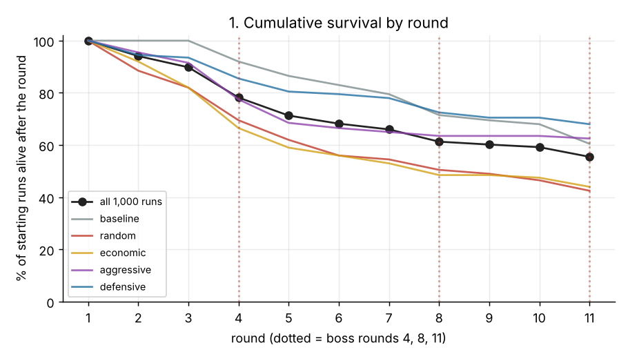
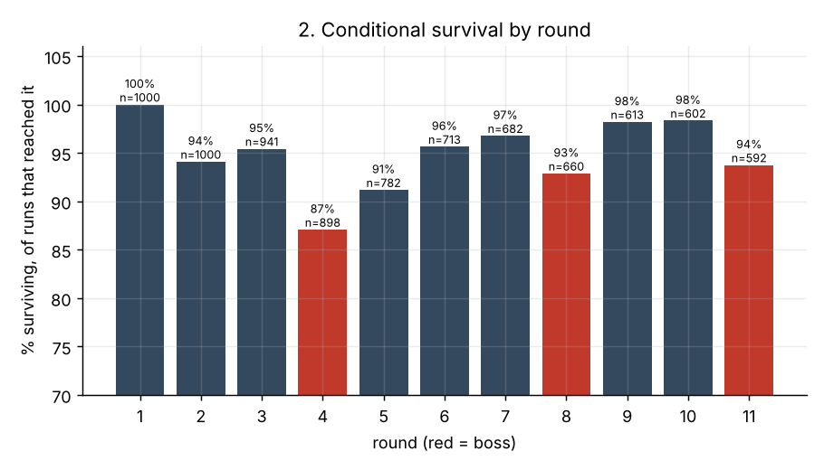

Conditional survival uses only runs that reached the round; cumulative uses all 1,000 starting runs.

|   Round |   Reached |   Bankrupt | Cond. survival   | Cum. survival   |   Raw penalty (mean) |   Penalty paid (mean) |   Penalty paid (median) |   Rewards (mean) |   Regalia income (mean) |   Court spend (mean) |   Net at settlement (mean) |   Treasury start (median) |   Treasury after settlement (median) |
|--------:|----------:|-----------:|:-----------------|:----------------|---------------------:|----------------------:|------------------------:|-----------------:|------------------------:|---------------------:|---------------------------:|--------------------------:|-------------------------------------:|
|       1 |      1000 |          0 | 100.0%           | 100.0%          |                 9.15 |                  4.01 |                    0.00 |            10.33 |                    0.00 |                10.70 |                       6.32 |                     25.00 |                                32.00 |
|       2 |      1000 |         59 | 94.1%            | 94.1%           |                 8.65 |                  3.79 |                    3.00 |             9.73 |                    0.63 |                 7.68 |                       6.06 |                     18.00 |                                28.00 |
|       3 |       941 |         43 | 95.4%            | 89.8%           |                 4.95 |                  2.63 |                    0.00 |            12.84 |                    1.56 |                 7.40 |                      10.28 |                     16.00 |                                29.50 |
|       4 |       898 |        116 | 87.1%            | 78.2%           |                 7.38 |                  7.02 |                    0.00 |            18.50 |                    2.69 |                 5.18 |                      11.82 |                     19.00 |                                39.50 |
|       5 |       782 |         69 | 91.2%            | 71.3%           |                 7.81 |                  7.41 |                    0.00 |            12.46 |                    3.28 |                 5.89 |                       5.32 |                     33.00 |                                42.00 |
|       6 |       713 |         31 | 95.6%            | 68.2%           |                 4.29 |                  4.15 |                    0.00 |            17.65 |                    5.52 |                 5.96 |                      13.64 |                     34.00 |                                49.00 |
|       7 |       682 |         22 | 96.8%            | 66.0%           |                 4.97 |                  4.48 |                    0.00 |            19.75 |                    7.39 |                 5.15 |                      15.44 |                     41.50 |                                57.00 |
|       8 |       660 |         47 | 92.9%            | 61.3%           |                10.70 |                  9.81 |                    0.00 |            20.08 |                    5.74 |                 3.94 |                      10.50 |                     52.00 |                                64.00 |
|       9 |       613 |         11 | 98.2%            | 60.2%           |                 4.72 |                  4.33 |                    0.00 |            19.45 |                    7.75 |                 4.49 |                      15.20 |                     60.00 |                                71.00 |
|      10 |       602 |         10 | 98.3%            | 59.2%           |                 3.64 |                  3.52 |                    0.00 |            20.77 |                    8.31 |                 4.08 |                      17.31 |                     66.00 |                                83.00 |
|      11 |       592 |         37 | 93.8%            | 55.5%           |                15.60 |                 14.17 |                    5.00 |            13.54 |                    4.45 |                 0.00 |                      -0.40 |                     79.00 |                                82.00 |

**Reading it.** Difficulty is **not smooth**. The four weakest rounds are round 4 (87.1%), round 5 (91.2%), round 8 (92.9%), round 11 (93.8%) — three of them boss rounds. **Round 2's dip is Court overspending:** no baseline run goes bankrupt in rounds 1–3 (the Act 1 cap means anyone holding 10+ gold is safe), so every early bankruptcy follows a purchase. **Round 5** follows The Miser with no Act 1 cap in place: the runs that go bankrupt there arrive with a median of 13 gold and face a median bill of 24; spenders suffer most (bankruptcy rate at round 5: defensive 6%, baseline 6%, random 11%, economic 11%, aggressive 12%).

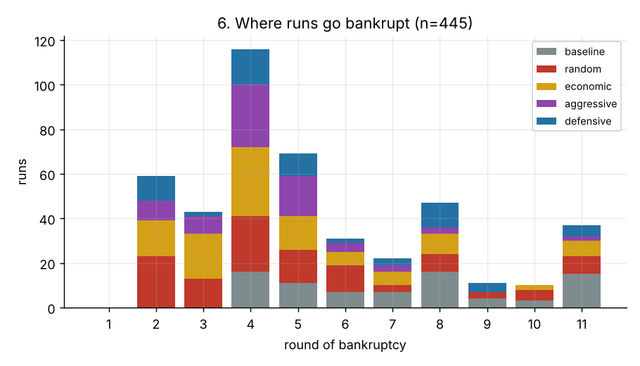

### Bosses

| Boss    |   Round |   Reached |   Beaten | Success   |   Player out rate |   Treasury on entry (median) |   Raw penalty (mean) |   Penalty paid (mean) |   Net gold in round (mean) |   Runs ended here | % of arrivals ended   |
|:--------|--------:|----------:|---------:|:----------|------------------:|-----------------------------:|---------------------:|----------------------:|---------------------------:|------------------:|:----------------------|
| miser   |       4 |       898 |      438 | 48.8%     |              0.43 |                        19.00 |                 7.38 |                  7.02 |                      11.82 |               116 | 12.9%                 |
| jester  |       8 |       660 |      269 | 40.8%     |              0.34 |                        52.00 |                10.70 |                  9.81 |                      10.50 |                47 | 7.1%                  |
| usurper |      11 |       592 |      123 | 20.8%     |              0.15 |                        79.00 |                15.60 |                 14.17 |                      -0.40 |                37 | 6.2%                  |

Boss success by Court policy:

| boss    |   baseline |   random |   economic |   aggressive |   defensive |
|:--------|-----------:|---------:|-----------:|-------------:|------------:|
| miser   |      0.480 |    0.488 |      0.470 |        0.536 |       0.465 |
| jester  |      0.321 |    0.477 |      0.302 |        0.669 |       0.301 |
| usurper |      0.162 |    0.215 |      0.126 |        0.362 |       0.163 |

- **The Miser (round 4) is the single deadliest point:** 116 runs end there (11.6% of all runs), and runs arrive with a median of only 19 gold because early Court spending has drained them.
- **The Usurper (round 11) is the hardest to *beat*** (20.8% success; the player goes out only 15% of the time versus 42% overall) **but rarely lethal** (6.2% of arrivals), since arriving treasuries are large (median 79). It costs points, not runs.
- **The Jester (round 8)** is the one where builds matter most: Aggressive runs beat it 67% of the time versus 30% for Defensive and Economic, 32% for the baseline and 48% for Random. Extra wild ranks and the extra Joker blunt a wild that changes every turn. This is a build interaction worth watching, not proof of an unfair boss.

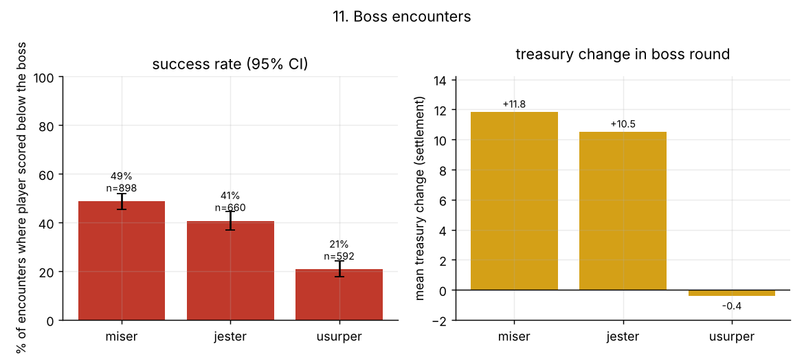

## 5. Gold economy

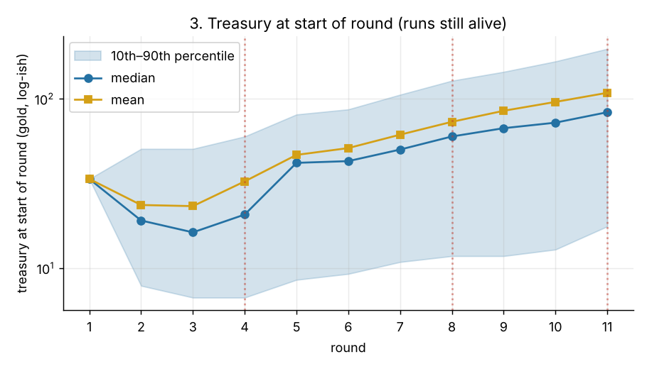
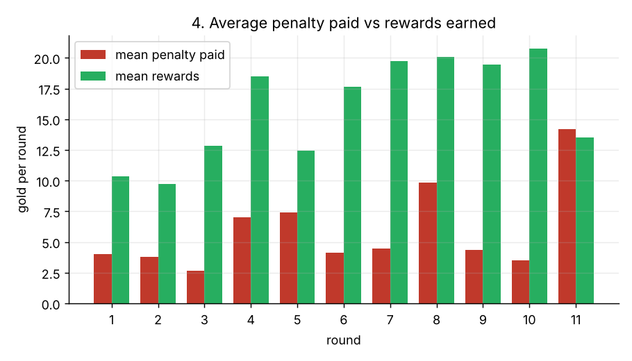

- **Gaining or losing?** Players gain gold on average in every round from 1 to 10 (net at settlement +5.3 to +17.3); round 11 is roughly break-even (-0.4).
- **Inflation:** yes. Median start-of-round treasury 25 → 79; the 90th percentile at round 11 is 236. After the Regalia and Decree slots are full, gold has nothing to buy.
- **Penalty vs rewards.** The raw hand penalty exceeds that round's rewards in 33.2% of settlements overall and in 52.5% of round 11 settlements. Averaged per round, rewards exceed penalties paid in rounds 1–10; in round 11 they are about equal (14.2 paid vs 13.5 rewards).
- **Approaching bankruptcy.** 47.1% of runs dipped below 15 gold at some settlement, 27.6% below 10, 7.7% below 5. Of those, 63.3% / 56.9% / 44.2% later reached 25+ gold again (*recovery here = ended a later round at ≥ the starting 25 gold*).
- **Act 1 cap.** It bound in 27.0% of Act 1 rounds, saving 11,703 gold in total. For the no-purchase baseline it works perfectly: **0 baseline runs went bankrupt in rounds 1–3**. It does not protect runs that spend the treasury down: 102 runs went bankrupt in rounds 2–3, all in buying groups (random 36, economic 36, aggressive 17, defensive 13).
- **Second Wind** fired 67 times (restoring 1,266 gold in total). **Miser's Vault** cap applied 47 times (saving 762 gold). **Gambler's Hand** extra penalty hit 284 times costing 2,369 gold, against 19,470 gold of extra going-out reward.

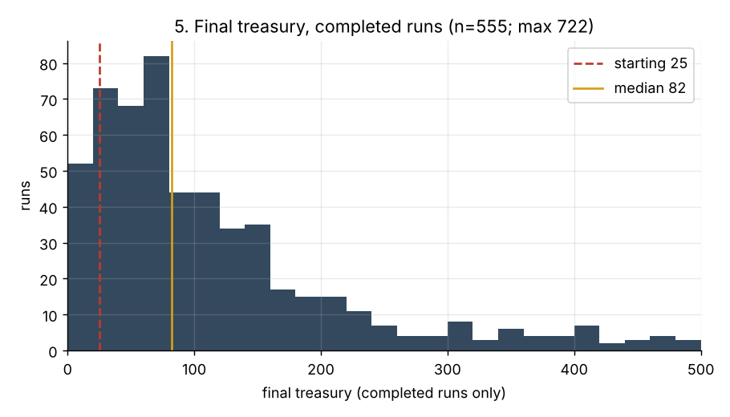

Final treasury, completed runs only (bankrupt runs are reported separately and not mixed in):

| Final treasury   |   Completed runs | Share   |
|:-----------------|-----------------:|:--------|
| 0–5              |                7 | 1.3%    |
| 6–15             |               31 | 5.6%    |
| 16–30            |               59 | 10.6%   |
| 31–50            |               67 | 12.1%   |
| 51+              |              391 | 70.5%   |

## 6. Strategy comparison

| Group      |   Runs |   Completed | Completion (95% CI)   |   Mean round reached |   Median final treasury (completed) | Mean gold spent (purchases / rerolls)   |   Items bought / run |
|:-----------|-------:|------------:|:----------------------|---------------------:|------------------------------------:|:----------------------------------------|---------------------:|
| baseline   |    200 |         121 | 60.5% (54%–67%)       |                 9.50 |                               79.00 | 0.0 / 0.0                               |                 0.74 |
| random     |    200 |          85 | 42.5% (36%–49%)       |                 7.58 |                               71.00 | 68.6 / 12.6                             |                 8.71 |
| economic   |    200 |          88 | 44.0% (37%–51%)       |                 7.53 |                              112.50 | 27.5 / 10.7                             |                 3.72 |
| aggressive |    200 |         125 | 62.5% (56%–69%)       |                 8.55 |                              237.00 | 60.6 / 9.6                              |                 7.12 |
| defensive  |    200 |         136 | 68.0% (61%–74%)       |                 9.25 |                               33.50 | 49.6 / 11.6                             |                 7.21 |
| ALL        |   1000 |         555 | 55.5% (52%–59%)       |                 8.48 |                               82.00 | 41.3 / 8.9                              |                 5.50 |

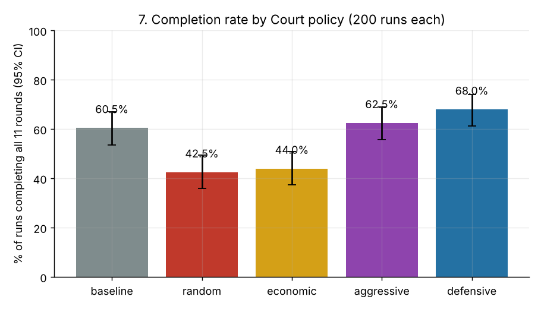
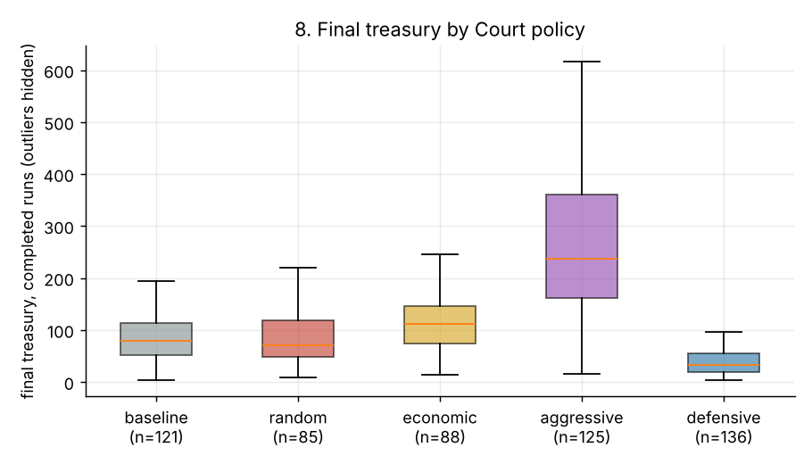

Difference from the no-purchase baseline (200 runs each, so each rate carries roughly ±7 points):

| Group      | Completion   |   vs baseline (pts) |   p (two-proportion z) | Sensitivity (reserve 10)   |   sens. vs baseline (pts) |   sens. p |
|:-----------|:-------------|--------------------:|-----------------------:|:---------------------------|--------------------------:|----------:|
| random     | 42.5%        |               -18   |                  0     | 42.5%                      |                       -18 |     0     |
| economic   | 44.0%        |               -16.5 |                  0.001 | 45.5%                      |                       -15 |     0.003 |
| aggressive | 62.5%        |                 2   |                  0.681 | 66.5%                      |                         6 |     0.213 |
| defensive  | 68.0%        |                 7.5 |                  0.118 | 72.5%                      |                        12 |     0.011 |

- **Strongest:** Defensive, then Aggressive. Defensive (68.0%, sensitivity 72.5%) is the only policy to beat the baseline convincingly, and only once it keeps 10 gold in reserve.
- **Weakest:** Random and Economic, both significantly below the baseline. Economic buys gold generators that pay off late, but 73% of its bankruptcies happen in rounds 2–5, before they pay off. Among the survivors it finishes richer than the baseline (median 112 vs 79). Defensive finishes with far less gold (median 34) because it spends on its set and its Regalia mostly save rather than earn.
- **Aggressive** survives about as often as the baseline but finishes with enormous treasuries (median 237, max 722), driven by Gambler's Hand and Early Bird.
- **Caveats.** The policies are my heuristics, not optimal play. Differences of under ~10 points between groups are within sampling noise at 200 runs each. The reserve sensitivity (+1.5 to +4.5 points for the listed policies) shows how much an arbitrary policy parameter can move a result. The Baseline is not a pure "no items" control: it takes the free pick after a boss win (628 free picks across all groups, 147 of them in the baseline).

## 7. Regalia and Decrees

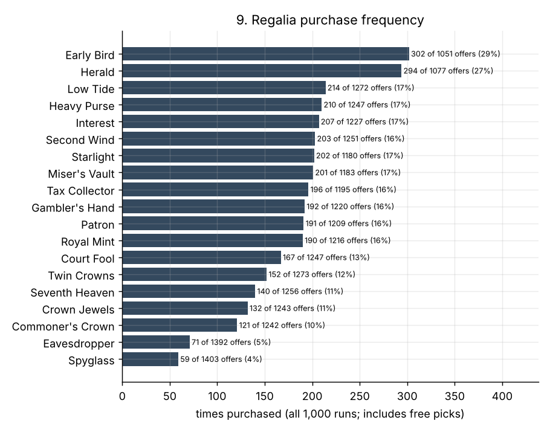
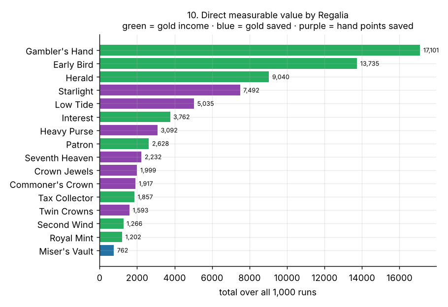

| Regalia          |   Price |   Offered |   Bought | Buy rate   |   Runs owning | Direct value per owned round   | Completion, owners at round 5 (n)   | Completion, non-owners at round 5   |
|:-----------------|--------:|----------:|---------:|:-----------|--------------:|:-------------------------------|:------------------------------------|:------------------------------------|
| Seventh Heaven   |      24 |      1256 |      140 | 11.2%      |           137 | 8.72 pts/round                 | 85% (82)                            | 69%                                 |
| Crown Jewels     |      24 |      1243 |      132 | 10.6%      |           132 | 8.19 pts/round                 | 93% (73)                            | 69%                                 |
| Commoner's Crown |      22 |      1242 |      121 | 9.7%       |           121 | 8.16 pts/round                 | 83% (72)                            | 70%                                 |
| Twin Crowns      |      16 |      1273 |      152 | 11.9%      |           149 | 5.12 pts/round                 | 80% (83)                            | 70%                                 |
| Court Fool       |      15 |      1247 |      167 | 13.4%      |           163 | n/a (no direct gold effect)    | 85% (85)                            | 69%                                 |
| Starlight        |      13 |      1180 |      202 | 17.1%      |           199 | 8.56 pts/round                 | 86% (117)                           | 68%                                 |
| Low Tide         |      13 |      1272 |      214 | 16.8%      |           208 | 5.64 pts/round                 | 80% (106)                           | 70%                                 |
| Miser's Vault    |      12 |      1183 |      201 | 17.0%      |           200 | 0.71 gold/round                | 81% (100)                           | 70%                                 |
| Spyglass         |      10 |      1403 |       59 | 4.2%       |            56 | n/a (no direct gold effect)    | 57% (21)                            | 71%                                 |
| Interest         |      10 |      1227 |      207 | 16.9%      |           204 | 3.69 gold/round                | 68% (110)                           | 71%                                 |
| Patron           |      10 |      1209 |      191 | 15.8%      |           188 | 2.79 gold/round                | 73% (101)                           | 71%                                 |
| Second Wind      |       9 |      1251 |      203 | 16.2%      |           182 | 1.29 gold/round                | 87% (92)                            | 69%                                 |
| Heavy Purse      |       9 |      1247 |      210 | 16.8%      |           205 | 4.00 pts/round                 | 77% (97)                            | 70%                                 |
| Herald           |       9 |      1077 |      294 | 27.3%      |           291 | 5.82 gold/round                | 68% (169)                           | 72%                                 |
| Tax Collector    |       9 |      1195 |      196 | 16.4%      |           190 | 1.88 gold/round                | 67% (109)                           | 72%                                 |
| Royal Mint       |       6 |      1216 |      190 | 15.6%      |           188 | 1.26 gold/round                | 63% (101)                           | 72%                                 |
| Early Bird       |       6 |      1051 |      302 | 28.7%      |           297 | 8.16 gold/round                | 77% (183)                           | 69%                                 |
| Eavesdropper     |       5 |      1392 |       71 | 5.1%       |            69 | n/a (no direct gold effect)    | 53% (38)                            | 72%                                 |
| Gambler's Hand   |       4 |      1220 |      192 | 15.7%      |           186 | 20.26 gold/round               | 79% (97)                            | 70%                                 |

*Direct value:* income and Vault figures are gold. Hand-rule Regalia (wilds, Low Tide, Starlight, Purse, Twin) are shown as **points saved on the final hand with that rule switched off** (same cards; before caps, and ignoring that these Regalia also help a player *go out*, which is not captured). Court Fool, Spyglass and Eavesdropper have no direct gold effect that can be measured.

*Owner vs non-owner:* to reduce survivor bias (an expensive Regalia can only be bought by a run that stayed alive long enough) the last two columns look only at runs still alive at the start of round 5. Raw owner/non-owner completion across all runs is in `regalia_results.csv` but flatters expensive items. This is still an **association, not a cause**: owners differ from non-owners in strategy, gold and luck. Owner group sizes at round 5 range from 21 to 183 runs, so the smaller ones are shaky.

- **Most frequently bought:** Early Bird, Herald, Low Tide (cheap, and favoured by several policies). **Rarest:** Spyglass and Eavesdropper (bought only by the Random policy or as free picks).
- **Most impactful (direct gold):** Gambler's Hand, then Early Bird and Herald.
- **Strongest survival association (round-5 landmark):** the wild-making and hand Regalia — Crown Jewels 93%, Second Wind 87%, Starlight 86%, Seventh Heaven 85% — against 70% for non-owners.
- **Income Regalia do not show that association** (Royal Mint 63%, Tax Collector 67%, Interest 68%, Patron 73%, Herald 68%), and several sit at or below the non-owner rate.

**Pairs** (held together at the end of a run; ≥90 runs only):

| Pair held at end of run   |   Runs | Completion   |
|:--------------------------|-------:|:-------------|
| earlybird+herald          |    150 | 68%          |
| purse+vault               |    112 | 85%          |
| lowtide+vault             |    109 | 86%          |
| lowtide+purse             |    109 | 92%          |
| lowtide+starlight         |    109 | 92%          |
| starlight+vault           |    103 | 93%          |
| purse+starlight           |    103 | 94%          |
| interest+tax              |     99 | 68%          |

These pairs mostly reflect what a single policy buys together (e.g. the Defensive set), so they are not evidence of synergy. Of 169 observed pairs, 52 have 30+ runs; the rest are too rare to say anything about (full list in `regalia_combinations.csv`).

### Decrees

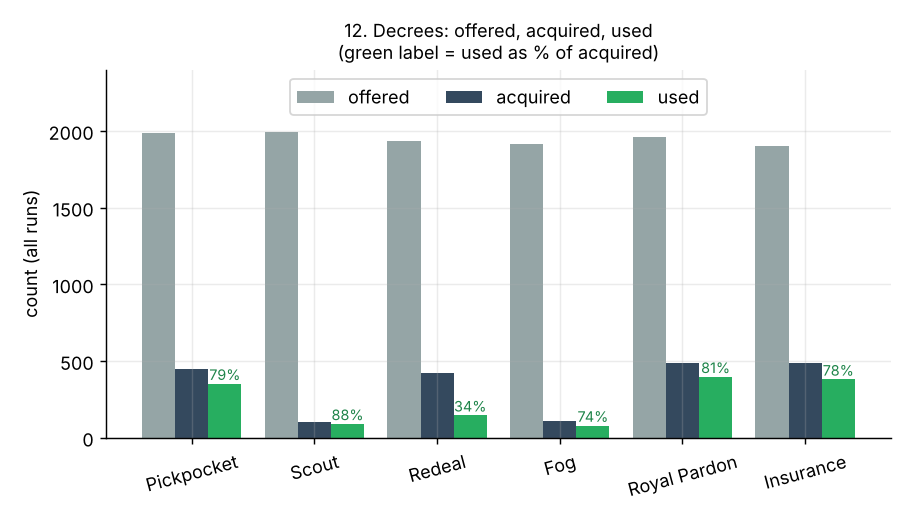

| Decree       |   Price |   Offered |   Acquired | Acquire rate   |   Used | Used / acquired   |   Unused at run end |   Offered while 3 held |   Avg round used | Gold saved per use   |
|:-------------|--------:|----------:|-----------:|:---------------|-------:|:------------------|--------------------:|-----------------------:|-----------------:|:---------------------|
| Pickpocket   |       4 |      1985 |        447 | 22.5%          |    352 | 79%               |                  95 |                    167 |             6.59 | —                    |
| Scout        |       3 |      1992 |        102 | 5.1%           |     90 | 88%               |                  12 |                    164 |             5.40 | —                    |
| Redeal       |       5 |      1937 |        424 | 21.9%          |    146 | 34%               |                 278 |                    140 |             4.97 | —                    |
| Fog          |       3 |      1918 |        107 | 5.6%           |     79 | 74%               |                  28 |                    149 |             5.52 | —                    |
| Royal Pardon |       4 |      1958 |        488 | 24.9%          |    397 | 81%               |                  91 |                    167 |             6.91 | 5.88                 |
| Insurance    |       5 |      1902 |        486 | 25.6%          |    380 | 78%               |                 106 |                    162 |             7.00 | 6.77                 |

Insurance and Royal Pardon pay back roughly their price in gold saved when used by this heuristic (6.8 gold per use for a price of 5; 5.9 for 4). Redeal is acquired often but used only 34% of the time under my heuristic, and 278 were still unused when runs ended. That reflects my use-rule at least as much as the Decree itself. Scout and Fog were bought almost only by the Random policy (the listed policies leave them out).

## 8. Findings and recommendations

*Classification:* **Evidence-backed** = adequate data from this simulation. **Potential** = plausible, needs more samples or controlled testing. **Not enough evidence** = missing data or implementation detail. No change below has been made to the game.

| # | Finding | Class | Evidence | Possible response | What to measure next |
|---|---|---|---|---|---|
| 1 | Gambler's Hand is far cheaper than the gold it produces | Evidence-backed | price 4; ≈17.8 net gold per owned round vs 8.2 Early Bird (price 6), 5.8 Herald (9), 2.8 Patron (10); heavily drives Aggressive treasuries up to 722 | Raise its price or lower the ×3; expected effect is a smaller gold surplus, not necessarily lower survival | Re-run with the change; compare Aggressive final treasury and completion |
| 2 | Early deaths come from spending, not from the cards | Evidence-backed | 0 baseline busts in rounds 1–3; 102 busts in rounds 2–3 among buyers; sensitivity (reserve 10) cuts listed-policy early busts to 15 (from 66) | Optional: stronger on-screen warning when the treasury would fall below the Act 1 cap; no rule change needed | Observe real players' Court spending |
| 3 | The Miser (round 4) is the deadliest single round | Evidence-backed | 116 of 898 arrivals (12.9%); median entry treasury 19 | Mostly a result of low treasury on arrival; consider whether a cushion before round 4 is intended | Re-test after any Act 1 income change |
| 4 | Gold inflates and has no late sink | Evidence-backed (observation); whether it is a *problem* is a design call | median 25→79; 70.5% of completed runs finish with 51+ | If final gold is meant to matter, add a sink or a score; otherwise leave | Check against how final gold is shown to players |
| 5 | Income Regalia (Mint, Tax, Interest, Patron, Herald) add little survival | Potential | direct gold 1.3–3.7 per round (Herald 5.8); owner completion at round 5 63%–73% vs ≈72% non-owners; Economic group 44.0% vs baseline 60.5% | Consider moving their value earlier (Act 1) rather than later | Controlled test: force each Regalia on at round 1 |
| 6 | Wild-making and free-leftover Regalia (and Second Wind) look strongest for survival | Potential | owners at round 5: 83%–93% completion; Starlight saves ≈8.6 points per owned round | None yet; selection effects possible | Randomised assignment of each item at round 1 (cleanest test) |
| 7 | Purchasing is not clearly better than not purchasing | Potential | baseline 60.5% vs Aggressive 62.5%, Defensive 68.0% (sens. 72.5%) | Policy-dependent; a better policy might do much better | Try a stronger (search-based) Court policy |
| 8 | Usurper is hard to beat but rarely kills; Jester interacts with wild-making builds | Evidence-backed (rates); Potential (interaction) | Usurper success 20.8%, ends 6.2% of arrivals; Jester success Aggressive 67% vs 30% Defensive | None | Test builds head-to-head at the Jester |
| 9 | Early Bird's 3-turn window is met often by the AI | Potential (depends on human speed) | met in 37% of owned rounds; median player turns per round 3 | Check on human play before changing | Human turn counts per round |
| 10 | Miser's Vault rarely does anything | Potential | applied 47 times for 762 gold in total; price 12 | Possibly the wrong size for AI-sized penalties; humans may be caught with more | Human penalty distribution |
| 11 | Spyglass, Eavesdropper, Scout cannot be evaluated | Not enough evidence | The AI never uses the information | — | Human play study |
| 12 | Redeal, Pickpocket, Fog effects | Not enough evidence | use rules are my heuristics; no direct gold link | — | Better Decree-use policy, or A/B on a fixed hand |

## 9. Limits of this study

- **One player AI.** The player is the opponent AI at full strength every turn, so results are an upper bound on skill. The AI doesn't use hints, peeks or reading of opponents.
- **Rounds are short for the AI** (median 3 player turns, mean 3.4; the player goes out in 42% of rounds), which matters for turn-based items (Early Bird, Scout, Fog).
- **Court policies are hand-written** and only three of five are "strategies"; each has a parameter (reserve) that visibly moves the result.
- **Association is not causation** for every Regalia comparison (owner selection, survivor bias). The round-5 landmark reduces but does not remove this.
- **Direct-value numbers are counterfactual accounting on the same state** (e.g. Gambler: marginal going-out gold with the item vs. without it for that round), not re-simulations.
- **200 runs per group** gives about ±7 points of uncertainty on any completion rate; the pairwise tests are uncorrected for multiple comparisons.
- Opponent skill tiers and boss skill are as coded; I did not vary them.

## 10. Validation

Headline run: all 24 checks passed. Sensitivity run: all 24 checks passed.

- PASS: exactly 1000 runs recorded (1000 rows)
- PASS: every run id unique
- PASS: every run has a recorded seed, and seeds are unique
- PASS: five groups, 200 each (sums to 1000) ({"baseline":200,"random":200,"economic":200,"aggressive":200,"defensive":200})
- PASS: no run exceeds 11 rounds
- PASS: every run has one round record per round reached
- PASS: bankrupt runs stop at the bankrupt round (last record bankrupt, none after)
- PASS: completed runs reached round 11 and survived it
- PASS: every round ledger reconciles (before + credits - debits = after) (0 mismatches)
- PASS: ledger opening balance equals recorded start-of-round treasury
- PASS: no unrecognised ledger lines
- PASS: treasury never negative except the bankruptcy settlement
- PASS: every completed run ends with treasury >= 0
- PASS: Regalia capacity (<=5) and Decree capacity (<=3) respected
- PASS: bosses appear only on rounds 4 (miser), 8 (jester), 11 (usurper)
- PASS: Act 1 cap respected (rounds 1-3 penalty paid <= 10)
- PASS: Miser's Vault respected (penalty paid <= 25 whenever owned)
- PASS: boss bounty paid exactly when the player scored below the boss (and only on boss rounds)
- PASS: free picks never exceed bounties earned (no double counting) (628 free picks used / 830 bounties)
- PASS: every purchase was paid for (price 0 only when a free pick)
- PASS: baseline never paid for anything (only free bounty picks) (147 free picks taken)
- PASS: no placeholder / NaN values in numeric fields
- PASS: same seed + group reproduces the same run (10 re-runs)
- PASS: recorded seeds follow the documented scheme

Not placeholders: every figure above is read from the CSVs next to this file. Charts are drawn from those CSVs by `simulation/analyze.py`.

## 11. Files

`run_results.csv` (one row per run) · `round_results.csv` (one row per round reached, full ledger) · `event_log.csv` (offers, buys, rerolls, sales, Decree uses) · `regalia_results.csv` · `decree_results.csv` · `boss_results.csv` · `boss_by_group.csv` · `strategy_results.csv` · `round_summary.csv` · `regalia_combinations.csv` · `economy_extras.json` · `validation_results.json` · `simulation_config.json` · `simulation_manifest.json` · `charts/`. Sensitivity run: `../2026-11-16-run-002-reserve10/`.

Reproduce: `node simulation/run-sim.js --runs 1000 --out <dir>` then `node simulation/validate.js <dir>`, `python3 simulation/analyze.py <dir>`, `python3 simulation/make_report.py <dir> <sensitivityDir>`.
